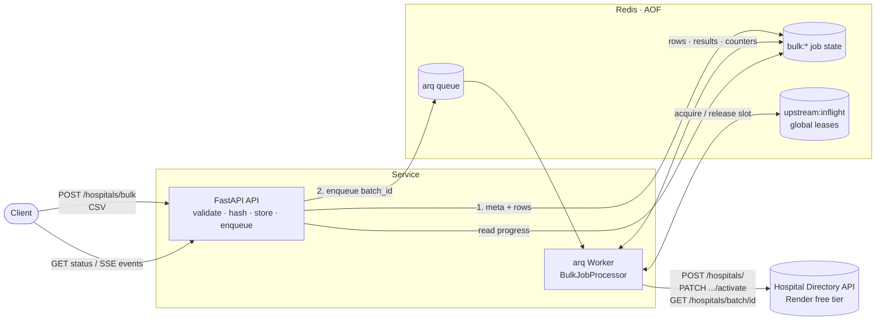
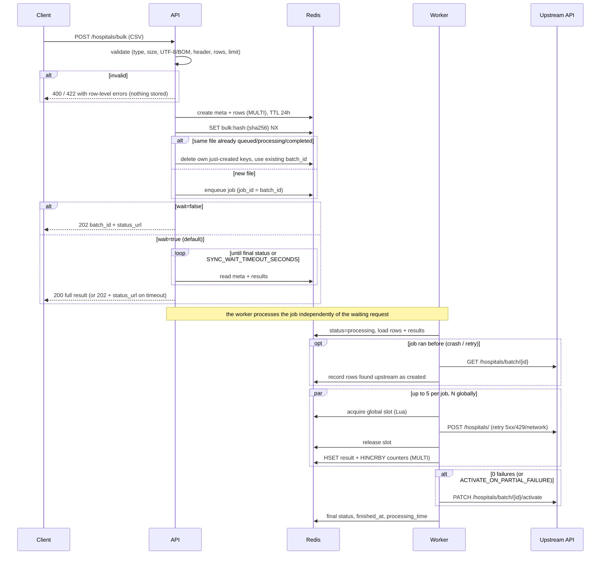

# Hospital Bulk Processor

**Live demo:** `https://<your-service>.onrender.com` (Swagger UI at [`/docs`](https://<your-service>.onrender.com/docs)).
This runs on Render's free tier, so the first request after about 15 minutes idle can take 30–60s while it wakes up.
See [Deployment](#deployment-render-free-tier).

A FastAPI service that accepts a CSV of hospitals and bulk-creates them through the
[Hospital Directory API](https://hospital-directory.onrender.com/docs). Uploads are validated
synchronously, then processed in the background by an [arq](https://arq-docs.helpmanual.io/) worker.
By default the upload request waits for that job and returns the full processing result. With `?wait=false` it
returns `202` immediately. Live progress is tracked in Redis and exposed via a status endpoint and a Server-Sent
Events stream.

- **Robust upstream calls**: timeouts, exponential backoff with jitter on network errors / 429 / 5xx, never on 4xx.
- **Two-level concurrency control**: up to 5 parallel calls per job, plus a **global** cap shared by every job and worker (held in Redis).
- **Idempotent uploads**: re-uploading the same file returns the existing batch instead of creating duplicates.
- **Crash-safe**: a restarted job skips rows already created and reconciles rows created upstream but not yet recorded.
- **Safe activation**: a batch is only activated when every row succeeded (configurable).

---

## Quick start

```bash
cp .env.example .env
docker compose up --build
```

| Service  | What it is                                   |
|----------|----------------------------------------------|
| `api`    | FastAPI on http://localhost:8000 (Swagger at `/docs`) |
| `worker` | arq worker (`arq app.worker.WorkerSettings`) |
| `redis`  | Redis 7 with AOF persistence (`appendonly yes`, `appendfsync everysec`) on a named volume |

```bash
curl localhost:8000/health                       # {"status":"ok","redis":"ok"}
curl -F "file=@sample.csv" localhost:8000/hospitals/bulk              # waits, returns the full result
curl -F "file=@sample.csv" "localhost:8000/hospitals/bulk?wait=false" # 202 + status_url right away
```

### Local development and tests

```bash
python3 -m venv .venv
.venv/bin/pip install -r requirements-dev.txt
.venv/bin/pytest -q            # 136 tests, ~2.5s, never touches the real API
.venv/bin/ruff check app tests
```

Tests use **fakeredis** (with Lua, for the rate limiter) and **respx** to fake the upstream API.
`tests/upstream.py` is a scripted fake of the upstream API that can inject 5xx/4xx responses, add latency,
and record peak concurrency.

---

## Deployment (Render free tier)

The repo includes a [Render Blueprint](https://render.com/docs/infrastructure-as-code) in [`render.yaml`](render.yaml).
It creates two resources:

| Resource | Plan | Notes |
|---|---|---|
| `hospital-bulk-redis` (Key Value) | free | Internal-only (`ipAllowList: []`). `maxmemoryPolicy: noeviction`, so queue and job keys are never silently evicted |
| `hospital-bulk-processor` (web service, Docker) | free | Built from the `Dockerfile`, started with [`scripts/start.sh`](scripts/start.sh), health check `/health`. `REDIS_URL` comes from the Key Value instance's connection string |

To deploy:
1. Fork or push this repo to GitHub.
2. In the Render dashboard choose **New → Blueprint**, connect the repo and pick the `main` branch.
3. Review the two resources and click **Deploy Blueprint**.
4. When the web service shows **Live**, open `https://<your-service>.onrender.com/docs`.

Every other setting from [`.env.example`](.env.example) is already in `render.yaml` with the same defaults. You can
change them later under the web service's **Environment** tab.

### Single container: free-tier demo only
Render's free plan has no Background Worker service, so `scripts/start.sh` runs the **arq worker and uvicorn in one
container**:
- Uvicorn binds to `$PORT`.
- If either process dies, the script stops the other and exits non-zero, so Render restarts the container.
- On SIGTERM (deploys, restarts) the script forwards the signal to both processes and waits. The worker's drain logic therefore still finishes in-flight upstream requests.
- Free services can't change Render's shutdown grace period (`maxShutdownDelaySeconds`), so the container is force-killed 30s after SIGTERM. The Blueprint therefore sets `WORKER_DRAIN_SECONDS=25`, down from 75 locally. If an upstream request is still running when the 25s are up, it is cancelled. The resumed job's reconcile step (`GET /hospitals/batch/{id}`) then catches any row that was committed anyway. On a paid plan, set `maxShutdownDelaySeconds: 90` and keep the drain at 75s.

**In production the API and worker run as separate services.** That means a `type: web` service and a
`type: worker` service on paid plans, exactly as `docker-compose.yml` does locally, so they scale and restart
independently.

### Free-tier caveats
- **Cold starts:** free web services sleep after about 15 minutes without traffic. The next request wakes them and can take **30–60s**. The worker sleeps too, so `wait=false` jobs queued just before a sleep finish when the service wakes. The default `wait=true` request keeps the service awake until its job is done.
- **No Redis persistence:** free Key Value instances don't persist data, unlike the AOF-enabled Redis in `docker-compose.yml`. A Key Value restart loses queued jobs and progress. For the demo that's acceptable; for production use a paid instance with persistence.
- **Small instance:** 0.1 CPU and 512 MB, shared by both processes. That's fine for 20-row uploads.
- The upstream Hospital Directory API is also on Render's free tier, so it can cold-start in the middle of a job. The client's 60s timeout and retries cover that.

---

## Architecture



### Upload and processing flow



### Code layout

```
app/
  config.py               all settings, from env (pydantic-settings)
  main.py                 app factory, lifespan, exception handlers
  routes/                 thin HTTP handlers (health, bulk)
  services/bulk_service.py    upload / validate / retry / status / SSE use cases
  services/bulk_processor.py  the job: resume, reconcile, create rows, activate
  clients/hospital_api.py     async httpx client with retries
  csv_validation.py       synchronous CSV validation
  progress_store.py       ALL Redis access for job state
  rate_limiter.py         global in-flight limiter (Redis + Lua)
  job_queue.py            arq behind a small protocol
  worker.py               arq entrypoint, retry policy, wiring
  models.py / schemas.py  domain models / API response models
```

Route handlers contain no business logic. Services depend on small protocols (`JobQueue`, `UpstreamLimiter`),
which is what makes the fast, network-free tests possible.

---

## API

| Method | Path | Purpose |
|---|---|---|
| `POST` | `/hospitals/bulk` | Upload CSV. Default (`wait=true`): `200` with the full result. `wait=false`: `202` with `batch_id` and `status_url` |
| `GET` | `/hospitals/bulk/{batch_id}/status` | Progress, counters, per-row results, timestamps |
| `GET` | `/hospitals/bulk/{batch_id}/events` | Server-Sent Events: `progress` on every change, then `complete` |
| `POST` | `/hospitals/bulk/{batch_id}/retry` | Re-queue only failed rows, activate when all succeed |
| `POST` | `/hospitals/bulk/validate` | Validate a CSV without processing it |
| `GET` | `/health` | Liveness + Redis connectivity (503 if Redis is down) |

**CSV format**: header `name,address,phone` (case/order-insensitive, `phone` column optional), UTF-8 (a BOM is
fine), at most `MAX_CSV_ROWS` (20) data rows and `MAX_UPLOAD_BYTES` (1 MiB). Row numbers in errors and results are
1-based data rows (the header is not counted).

### Upload

`POST /hospitals/bulk` takes one query parameter:

| `wait` | Behaviour |
|---|---|
| `true` (default) | Enqueue the job, wait for it to finish, return **`200`** with the full result. The body is the same as `GET .../status`. If the job isn't finished after `SYNC_WAIT_TIMEOUT_SECONDS` (120s), return **`202`** with `batch_id` and `status_url` instead. The job keeps running and nothing is lost. |
| `false` | Enqueue and return **`202`** right away with `batch_id` and `status_url`. |

**Synchronous (default).** `200` covers `completed`, `partial_failure` and `failed` jobs, so check `status` and
`batch_activated`.

```bash
curl -F "file=@sample.csv" localhost:8000/hospitals/bulk
```
```json
{"batch_id":"a2cd6643-77d7-469e-9e00-dba2d124a0f1","filename":"sample.csv","status":"completed",
 "total_rows":5,"processed":5,"succeeded":5,"failed":0,"percent_complete":100.0,"batch_activated":true,
 "created_at":"2026-10-30T15:06:52.683Z","started_at":"2026-10-30T15:06:52.781Z",
 "finished_at":"2026-10-30T15:06:59.606Z","processing_time_seconds":6.82,"error":null,
 "results":[{"row":1,"name":"Riverside General Hospital","status":"created","hospital_id":378,"error":null}, ...]}
```

**Asynchronous.**

```bash
curl -F "file=@sample.csv" "localhost:8000/hospitals/bulk?wait=false"
```
```json
{"batch_id":"a2cd6643-77d7-469e-9e00-dba2d124a0f1","status":"queued","total_rows":5,
 "duplicate":false,"status_url":"/hospitals/bulk/a2cd6643-77d7-469e-9e00-dba2d124a0f1/status"}
```

Uploading the same file again while that job is queued, processing or completed maps to the same `batch_id`.
With `wait=false` the response has `"duplicate": true`. In sync mode the request waits for the *existing* job and
returns its result, without creating any new hospitals.

### Validation errors

```bash
curl -F "file=@sample_invalid.csv" localhost:8000/hospitals/bulk      # → 422
```
```json
{"detail":"CSV contains invalid rows","errors":[
  {"row":2,"field":"name","message":"name is required"},
  {"row":3,"field":"address","message":"address is required"},
  {"row":4,"field":"phone","message":"phone contains invalid characters"},
  {"row":5,"field":null,"message":"Duplicate of row 1 (same name and address)"}]}
```

File-level problems (not `.csv`, too large, not UTF-8, empty, bad header, header only, too many rows) return
**400**. Row-level problems return **422** with every bad row listed, not just the first one.

### Status

```bash
curl localhost:8000/hospitals/bulk/$BATCH_ID/status
```
```json
{"batch_id":"a2cd...","filename":"sample.csv","status":"completed","total_rows":5,
 "processed":5,"succeeded":5,"failed":0,"percent_complete":100.0,"batch_activated":true,
 "created_at":"2026-10-30T15:06:52.683Z","started_at":"2026-10-30T15:06:52.781Z",
 "finished_at":"2026-10-30T15:06:59.606Z","processing_time_seconds":6.82,"error":null,
 "results":[{"row":1,"name":"Riverside General Hospital","status":"created","hospital_id":378,"error":null}, ...]}
```

`status` is one of `queued`, `processing`, `completed`, `partial_failure` or `failed`. Unknown batch → **404**.

### Live progress (SSE)

```bash
curl -N localhost:8000/hospitals/bulk/$BATCH_ID/events
```
```
event: progress
data: {"status":"processing","processed":2,"total_rows":5,"percent_complete":40.0,...}

event: complete
data: {"status":"completed","processed":5,...,"batch_activated":true}
```

In a browser: `new EventSource("/hospitals/bulk/<id>/events")`.

### Retry failed rows

```bash
curl -X POST localhost:8000/hospitals/bulk/$BATCH_ID/retry
```
```json
{"batch_id":"...","status":"queued","retried_rows":[2],"status_url":"/hospitals/bulk/.../status"}
```

Returns **409** while the job is queued or processing, or when it already completed. Concurrent retry calls are
safe: an atomic compare-and-set on `status` lets only one of them through.

### Validate only

```bash
curl -F "file=@sample.csv" localhost:8000/hospitals/bulk/validate
# {"valid":true,"total_rows":5,"rows":[{"row_number":1,"name":"Riverside General Hospital",...}]}
```

---

## Redis key design

| Key | Type | Contents | TTL |
|---|---|---|---|
| `bulk:{batch_id}:meta` | hash | `JobMeta` fields (status, filename, file_hash, total_rows, timestamps, `batch_activated`, error) **and** the `processed` / `succeeded` / `failed` counters | `JOB_TTL_SECONDS` (24h) |
| `bulk:{batch_id}:rows` | hash | `row_number → HospitalRow JSON`: the parsed upload | 24h |
| `bulk:{batch_id}:results` | hash | `row_number → RowResult JSON` (`created` + `hospital_id`, or `failed` + `error`) | 24h |
| `bulk:hash:{sha256}` | string | `batch_id` of the canonical job for that file content | `IDEMPOTENCY_TTL_SECONDS` (24h) |
| `upstream:inflight` | sorted set | global limiter leases: member = token, score = lease expiry | refreshed on every acquire |
| `arq:*` | (arq) | queue, job and result keys managed by arq | arq defaults |

Why this layout:
- **A `bulk:{batch_id}:` prefix per job**: everything about a job is easy to find, expire or delete together, and `bulk:*` never collides with arq's keys.
- **Hashes keyed by row number**: the worker, the retry endpoint and resume logic all need random access to individual rows ("has row 7 been created?"). A list or a JSON blob would force read-modify-write.
- **Counters live in the meta hash** and are updated with `HINCRBY` in the same `MULTI` as the row result, so `processed == len(results)` holds even with many rows finishing at once.
- **The idempotency key is content-addressed** (`sha256`), so the API can dedupe without parsing anything or scanning jobs.

---

## Design decisions and tradeoffs

### Why Redis plus a background worker (not a sync endpoint or `BackgroundTasks`)
- **The upstream is slow and flaky.** It runs on Render's free tier: cold starts take 30s or more and it occasionally returns 5xx. Twenty rows with retries can take minutes, far longer than a client or load balancer should hold an HTTP request open.
- **Live progress.** The worker writes after every row, so any API replica can serve status or SSE. `BackgroundTasks` keeps state inside one process, so another replica can't see it.
- **Crash recovery.** With `BackgroundTasks`, work dies with the process. With arq the job lives in Redis: if a worker dies or is redeployed, the job is re-run, and the resume logic (below) keeps that safe.
- **Scales past 20 rows.** Workers scale horizontally and the API only validates and enqueues. Validation still happens synchronously, so a bad file gets an immediate 400/422 and never reaches the queue.

### Sync by default, async underneath
The assignment expects the upload call to return the processing result, so `wait=true` is the default. That
doesn't change the architecture:
- The request still only validates, stores and enqueues. Then it polls the progress store until the job is final.
- The worker does all the processing, with its rate limiting, retries and resume logic unchanged.
- The wait is capped by `SYNC_WAIT_TIMEOUT_SECONDS`, below typical proxy and load balancer timeouts. A slow upstream therefore produces a `202` with a `status_url` rather than a dropped connection.
- If the client disconnects mid-wait, the job finishes anyway, because it is in the queue rather than in the request.

Clients that want the async model pass `wait=false`.

### Why arq rather than Celery
The work is concurrent async HTTP. arq is asyncio-native and uses Redis, which this service already needs for
progress, so there is no second broker. Celery would mean wrapping async code in `asyncio.run` per task (or using
gevent) and running RabbitMQ or Redis plus a result backend. The tradeoff is that arq has a smaller ecosystem and
no Flower-style UI.

### The upstream is the real bottleneck, hence the global limit
Each job runs at most `PER_JOB_CONCURRENCY` (5) requests at once (an `asyncio.Semaphore`). That alone does not
protect the upstream: 10 jobs on 3 workers could still send 50 concurrent requests to a free-tier instance and get
429/5xx storms. So every HTTP attempt also takes a **lease** from `upstream:inflight` (capped at
`UPSTREAM_MAX_IN_FLIGHT`). An atomic Lua script drops expired leases and takes a slot only if the set is under the
cap.
- Leases expire after `UPSTREAM_SLOT_TTL_SECONDS`, so a crashed worker can't leak capacity, which a plain `INCR`/`DECR` counter would.
- A slot is held only during the HTTP call, never during backoff sleeps.
- **Adding workers does not raise throughput** beyond what the upstream can take; it only adds parallel jobs that wait for slots. To go faster you raise the global cap, and only if the upstream can handle it.

### Retries
Network errors, 429 (honouring a numeric `Retry-After`) and 5xx are retried with exponential backoff and jitter
(0.5s, 1s, 2s… capped at 8s). 4xx responses are **never** retried: the request is wrong, so the row is marked
failed with the upstream's message. The per-request timeout is 60s to survive cold starts.

### Partial failure policy
By default a batch is activated **only if every row succeeded**. Otherwise the job ends as `partial_failure` and the
batch stays inactive.
- **Why:** a batch is one unit of work for the user. Activating 17 of 20 hospitals publishes an incomplete directory that people may act on. The user can fix the data or call `/retry`, which re-queues only the failed rows and activates once all succeed.
- **Configurable:** set `ACTIVATE_ON_PARTIAL_FAILURE=true` when partial availability matters more than completeness, for example when each hospital is independent. Status still reports `partial_failure`, with `batch_activated: true`.
- If every row fails the job is `failed`. If activation itself fails, the job is `failed` with an `error`, and `/retry` will re-attempt activation.

### Idempotency (duplicate uploads)
- The API writes the job first, then claims `bulk:hash:{sha256}` with `SET NX`.
- If the hash already points at a job that is queued, processing or completed, the new upload deletes its own keys and returns that job with `duplicate: true`. Claiming *after* storing means the winner's metadata always exists, which makes concurrent identical uploads safe (tested with 5 in parallel).
- After a `failed` or `partial_failure` job, or once the old job has expired, re-uploading starts a fresh batch. For partial failures, `/retry` is the recommended path.

### Resumability (no duplicate hospitals)
The upstream API has no idempotency keys, so the worker prevents duplicates itself in three layers:
1. **Skip what's recorded.** Rows with a result in `bulk:{id}:results` are never sent again.
2. **Reconcile on resume.** If the job started before (crash, redelivery or `/retry`), the worker first lists `GET /hospitals/batch/{id}` and records any row that already exists upstream, matched on (name, address). CSV validation rejects duplicate name+address pairs, so the match is unambiguous. If that list call fails, the job is retried rather than risk creating rows blind.
3. **Drain on shutdown.** When arq cancels a job (SIGTERM or deploy), rows already mid-request are allowed to finish and be recorded (up to `WORKER_DRAIN_SECONDS`), and queued rows are not started. Without this, a cancelled request can still commit upstream *after* the resumed job has reconciled. A real `docker compose stop worker` test found exactly that, and it is now covered by a test. `stop_grace_period` in compose is longer than the drain window.

Infrastructure errors (such as Redis blips) raise `arq.Retry` with a growing delay. On the final try the job is
marked `failed`.

### Durability: Redis is in-memory
AOF is enabled (`appendfsync everysec`) in `docker-compose.yml`, so queued jobs and progress survive a Redis
restart, losing at most about 1s of writes. The free Render Key Value used by the demo has no persistence (see
[Deployment](#deployment-render-free-tier)). All job keys expire after 24h. That keeps Redis small, but it means Redis is **not** an audit trail.
For a permanent record I would persist each finished job's metadata and per-row results to **Postgres** (in the
worker's `_finish`, or via an outbox), and keep Redis for hot progress only.

### Large files
Rows are stored in Redis because uploads are capped at 20 rows and 1 MiB. For large files I would stream the
upload to **object storage (S3)**, keep only the object key and progress counters in Redis, and have workers read
the file in chunks. That would also need `COUNT`-style progress rather than one result entry per row.

### SSE implementation
The stream polls the status in Redis every second and emits only when something changed. It also sends a
keep-alive comment every 15s for proxies. Polling reuses the status code path and works with any number of
workers. Redis pub/sub would be lower latency but adds a publish to the hot path, and messages are lost while no
one is subscribed.

---

## Configuration

Every value comes from the environment; see [`.env.example`](.env.example). The most important ones:

| Variable | Default | Meaning |
|---|---|---|
| `HOSPITAL_API_BASE_URL` | `https://hospital-directory.onrender.com` | Upstream API |
| `HOSPITAL_API_TIMEOUT_SECONDS` | `60` | Per-request timeout (cold starts) |
| `HOSPITAL_API_MAX_RETRIES` | `3` | Retries for 5xx/429/network errors |
| `MAX_CSV_ROWS` / `MAX_UPLOAD_BYTES` | `20` / `1048576` | Upload limits |
| `PER_JOB_CONCURRENCY` | `5` | Parallel upstream calls within one job |
| `UPSTREAM_MAX_IN_FLIGHT` | `10` | Global cap across all jobs and workers |
| `ACTIVATE_ON_PARTIAL_FAILURE` | `false` | Activate a batch even if some rows failed |
| `JOB_TTL_SECONDS` / `IDEMPOTENCY_TTL_SECONDS` | `86400` | Expiry of job state / duplicate detection |
| `WORKER_MAX_TRIES` / `WORKER_DRAIN_SECONDS` | `3` / `75` | Job retries / shutdown drain window |
| `SYNC_WAIT_TIMEOUT_SECONDS` | `120` | How long `POST /hospitals/bulk` (`wait=true`) waits before falling back to `202` |
| `SYNC_POLL_INTERVAL_SECONDS` | `0.5` | How often the waiting request re-reads progress from Redis |

---

## Testing

The code was built test-first. `git log` shows each `test:` (red) commit followed by its `feat:` (green) commit,
plus `refactor:` and one `fix:` commit for the bug found in the real crash test.

| Area | File | Covers |
|---|---|---|
| Upstream client | `test_hospital_api_client.py` | payload, 5xx/429/network retries, `Retry-After`, backoff caps, no retry on 4xx, limiter wraps only the HTTP call |
| CSV validation | `test_csv_validation.py` | BOM, CRLF, quoting, header rules, every file-level and row-level error, duplicates, limits |
| Progress store | `test_progress_store.py` | round trips, TTLs on every key, exact counters under 50 concurrent writes, reset, hash claim |
| Rate limiter | `test_rate_limiter.py` | cap, release, lease expiry, waiting, **global cap across 3 limiter instances** |
| Upload | `test_bulk_upload_api.py` | 202 response, stored before enqueue, 400/422 store nothing, 503 when the queue is down |
| Sync upload | `test_bulk_upload_sync.py` | default waits and returns 200 with the full result (same body as `/status`), partial failure, timeout → 202 while the job keeps running, `wait=false` → 202, duplicates wait for the existing job |
| Worker | `test_bulk_processor.py`, `test_worker.py` | activation, 5xx then success, 4xx not retried, partial failure not activated, policy flag, per-job and **cross-job global** concurrency, arq retry policy |
| Status / SSE | `test_bulk_status_api.py`, `test_bulk_events_api.py` | 404, percent, sorted results, end-to-end, event stream until `complete` |
| Idempotency / resume | `test_idempotency.py`, `test_resumability.py` | duplicate uploads (including concurrent ones), skip created rows, reconcile orphans, abort if reconciliation is impossible, drain on cancel |
| Retry / validate | `test_retry_validate_api.py` | 404/409 cases, only failed rows reset, unique arq job id, concurrent retries, full retry flow ending in activation |

---
